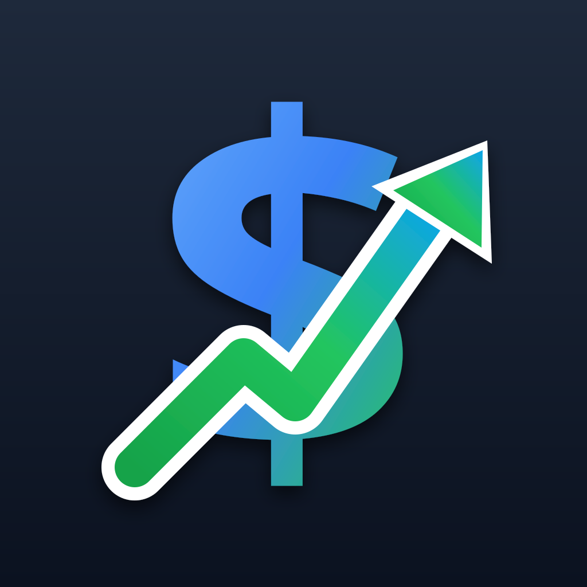

<p align="center">
  
</p>

<h1 align="center">CashFlow</h1>

<p align="center">
  App personal de finanzas para iPhone. Reemplaza mi sistema anterior de cuentas por bolsillos.<br>
  Swift 6 · SwiftUI · GRDB · compilada e instalada desde Arch Linux con <a href="https://xtool.sh">xtool</a>, sin Mac.
</p>

---

## Qué hace

La app sigue el mismo sistema que usaba en la sistema anterior: el ingreso del mes se reparte en **fondos** (bolsillos con propósito), **consumibles** (gastos fijos que se pagan poco a poco), **deudas** y **gastos necesarios**; lo que sobra es el saldo **libre para gastar**. Cada gasto sale de alguno de esos sitios o de una tarjeta de crédito.

- **Resumen** del mes: libre para gastar, cuánto por día, a dónde va el ingreso, últimos seis meses, fondos y tarjetas. Botón del ojo para ocultar montos y ver solo porcentajes.
- **Mes**: ingresos (con descuentos y bonos), aportes a fondos, consumibles, deudas y gastos necesarios. Cada categoría se trae del mes anterior con un botón. Un mes se puede **terminar** desde dos días antes de que acabe; la app pasa al siguiente como mes en curso.
- **Fondos**: saldo calculado desde movimientos, flujo por contraparte, traslados entre fondos, saldo real con un toque.
- **Tarjetas de crédito**: ciclos por fecha de corte y de pago, bolsillo de pago por tarjeta, abonos desde fondos o del saldo libre, pagos con comparación "tenía vs. pagué", cuota de manejo y cuotas de compras a crédito generadas solas en cada corte, cupo que descuenta las cuotas por facturar.
- **Gastos**: con y sin tarjeta, en pesos o dólares con TRM, búsqueda, totales por concepto, exportación CSV. Un gasto de fin de mes puede contar para el mes siguiente.
- Interfaz en inglés con español y francés. Diseño iOS 26 (Liquid Glass) con cinco acentos pastel. Bloqueo opcional con Face ID. Recordatorios de corte y pago. Acciones rápidas desde el ícono y enlace `cashflow://add` para registrar gastos desde Atajos.

## Cómo está hecha

| Capa | Qué hay |
|---|---|
| `Sources/CashFlowCore` | Modelos, esquema SQLite con migraciones, operaciones compuestas, cálculos en memoria (`Snapshot`), ciclos de tarjeta, dinero y fechas. Sin SwiftUI, se prueba en Linux. |
| `Sources/CashFlow` | La app SwiftUI. `AppModel` carga un `Snapshot` completo tras cada escritura. |
| `Tests/CashFlowCoreTests` | Swift Testing: lógica del mes, tarjetas, planes de cuotas, cierre, migración desde el esquema v1. |
| `Tools/Seed` | Herramienta de línea de comandos para cargar meses históricos sobre una copia de la base y para mantenimiento (`close`, `relink`, `migrate`, `sync`). |

Reglas que sostienen todo:

- Todo saldo se calcula desde movimientos. Nunca se guarda un saldo, salvo el inicial de un fondo.
- Dinero en enteros de la unidad menor (pesos, centavos de dólar). Los gastos en dólares guardan la TRM del momento.
- Las migraciones solo agregan. Los datos del teléfono no se pierden al reinstalar.
- "Gastado" es plata que salió de verdad. Los compromisos son plata apartada, no gasto.

## Compilar e instalar desde Linux

Requisitos: Swift 6.4, [xtool](https://xtool.sh) configurado con un Apple ID y el SDK de iOS extraído de Xcode, iPhone con Modo Desarrollador y conectado por USB.

```bash
swift test          # pruebas del núcleo
xtool dev build     # compila para iOS
xtool dev           # compila, firma e instala en el iPhone
```

Con Apple ID gratuito la firma caduca cada siete días; reinstalar no borra datos. Por la misma razón no hay widget ni App Groups.

## Estado

Beta personal en uso diario, versión `0.0.1` mientras dure la beta. El detalle de las decisiones de dominio y del flujo de trabajo está en [`CLAUDE.md`](CLAUDE.md) y el historial de fases en [`PLAN.md`](PLAN.md).
